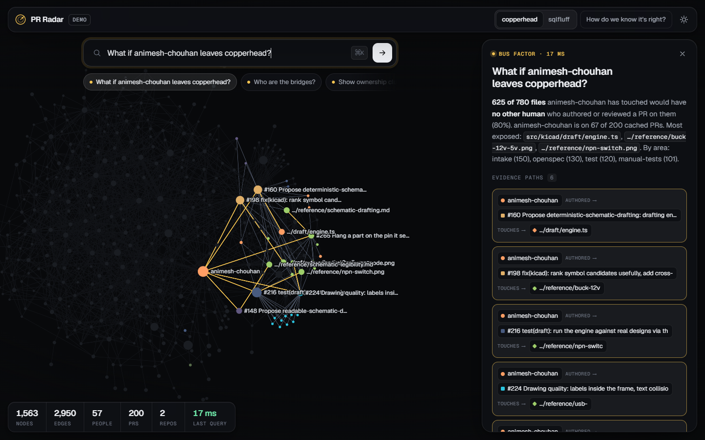
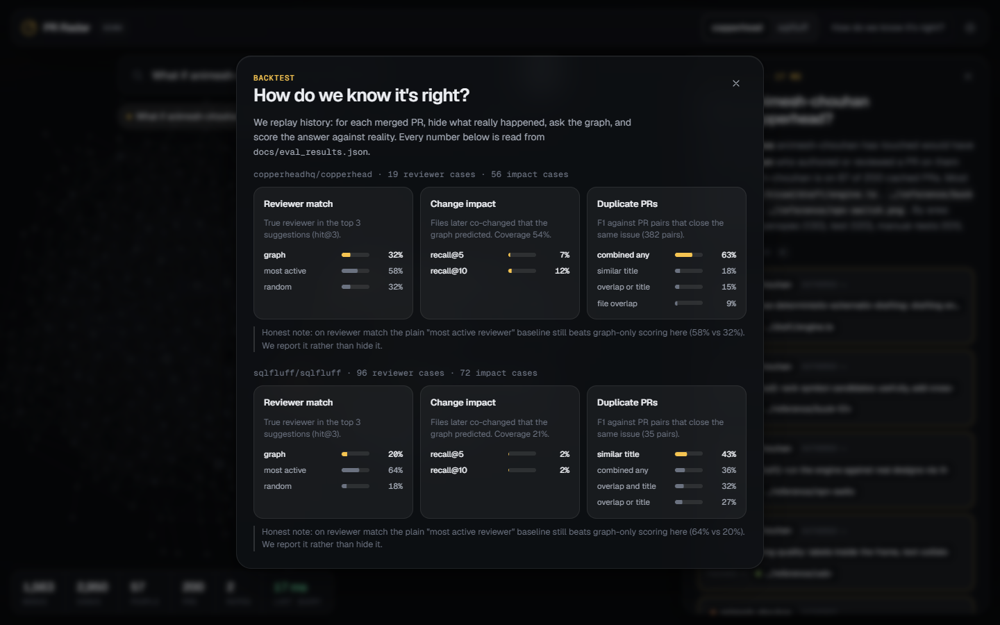
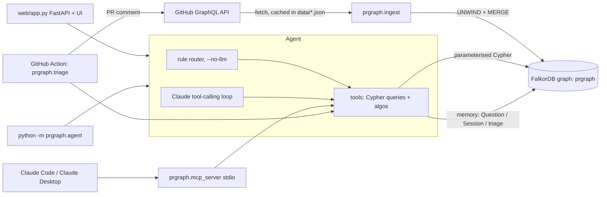
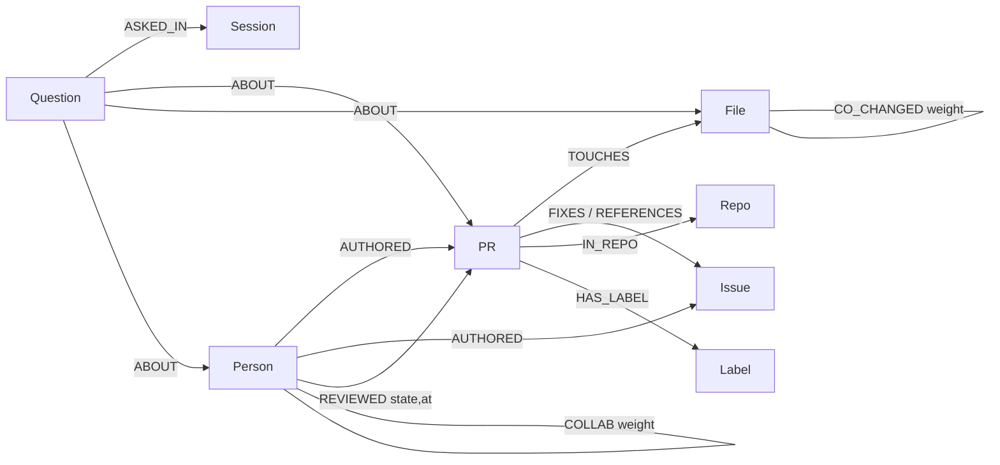

# pr radar

**a FalkorDB graph of who wrote, reviewed and touched what in a repo, and an agent that answers (and acts) with the graph path behind every claim.**

live demo: **https://pr-radar.onrender.com** · demo video: [link coming](docs/DEMO_SCRIPT.md) · backtest: [docs/EVAL.md](docs/EVAL.md)



## the moment

ask *"what if animesh-chouhan leaves copperhead?"* and pr radar walks `Person -AUTHORED|REVIEWED-> PR -TOUCHES-> File <- other humans`:

> **625 of 780 files** animesh-chouhan has touched would have **no other human** who authored or reviewed a PR on them (80%). he is on 67 of the 200 cached PRs.

each of those files comes with the path that proves it, so you can click through instead of trusting a summary.

## what it does

1. **acts on new PRs.** a GitHub action runs pr radar triage on every new PR in [adhavan18/pr-radar-demo](https://github.com/adhavan18/pr-radar-demo) and comments with what the graph found. see [PR Radar acts](#pr-radar-acts).
2. **answers with proof paths.** duplicates, reviewers, impact, stalls, ownership: every answer returns the FalkorDB `Path`s it came from (`alice -AUTHORED-> PR#12 -TOUCHES-> src/x.py <-TOUCHES- PR#40`).
3. **runs graph algorithms in the database.** `algo.pageRank` for key maintainers, `algo.betweenness` over derived `COLLAB` edges for people who bridge groups, `algo.labelPropagation` for ownership clusters, `algo.SPpaths` for "how is x connected to y".
4. **remembers.** questions, sessions and triage results are written back into the same graph and linked to the PRs, files and people they were about.
5. **plugs into other agents.** an MCP server exposes the same tools to Claude code and Claude desktop.

## pr radar acts

when a PR is opened, pr radar adds it to the graph, runs the duplicate, reviewer, co-change and bus-factor checks, posts one comment with the graph path behind every claim, labels the PR, and stores what it decided as a `Triage` node so later runs remember it.

live on [adhavan18/pr-radar-demo](https://github.com/adhavan18/pr-radar-demo), a demo copy of copperheadhq/copperhead (Apache-2.0, credited) loaded with copperhead's real review history:

| PR | what pr radar did |
|---|---|
| [#2](https://github.com/adhavan18/pr-radar-demo/pull/2) | flagged it as a possible duplicate: #3 fixes the same issue, and a real copperhead PR has a 0.88 title match on the same 4 files. listed `src/agent/loop.ts`, which changed with these files 29 times but isn't in this PR. labeled `possible-duplicate`. |
| [#3](https://github.com/adhavan18/pr-radar-demo/pull/3) | flagged the duplicate the other way, and recalled from graph memory that it had already flagged #2 for the same thing. |
| [#4](https://github.com/adhavan18/pr-radar-demo/pull/4) | touches `src/agent/loop.ts` alone. pointed out that `SPEC.md` (24x) and `create.ts` (21x) normally change with it. labeled `needs-review`. |

```bash
python -m prgraph.triage --repo adhavan18/pr-radar-demo --pr 2          # dry run, prints the comment
python -m prgraph.triage --repo adhavan18/pr-radar-demo --pr 2 --post   # post it (demo repo only)
```

to run it on every new PR, copy [examples/github-action/pr-radar.yml](examples/github-action/pr-radar.yml) into `.github/workflows/` and add the four `FALKORDB_*` repository secrets. posting is hard-limited to the demo repo, and comments never @-mention anyone.

## tracks

entering all three tracks.

**track 01: agents that act on connected data.** the agent plans over Cypher tools, traverses multi-hop relationships (PR to files to other PRs to their reviewers), and takes action: the triage action posts a comment on each new PR. every output is explainable through the returned paths.

**track 02: agent memory and coordination.** memory is graph-native: `Question`, `Session` and triage nodes, linked by `ABOUT` edges to the entities they concern. one memory is shared by every surface (web agent, CLI, MCP server, GitHub action), so a finding recorded by one is recalled by the others (`recall_about`).

**track 03: company brain.** for a codebase: who owns what (`bus_factor_files`), who knows what (`reviewers`, file expertise), what breaks if someone leaves (`bus_factor`, the moment above), ownership clusters (label propagation), bridges between groups (betweenness), and tracing decisions from a PR to the issue it fixes (`FIXES` / `REFERENCES`, `issue_fixed_by`).

## how do we know it's right?

`python -m prgraph.eval` replays 200 PRs per repo in creation order into a scratch graph and asks the real queries about each PR using only what existed before it (its own reviews are never visible). full method and every variant tried: [docs/EVAL.md](docs/EVAL.md); raw numbers: [docs/eval_results.json](docs/eval_results.json).

reviewer recommendation, before and after the eval-driven rewrite of `reviewers`:

| repo (PRs scored) | method | hit@1 | hit@3 | MRR |
|---|---|---|---|---|
| copperhead (19) | old query | 0.158 | 0.316 | 0.254 |
| | **current query** | **0.368** | 0.421 | 0.423 |
| | most-active baseline | 0.368 | 0.579 | 0.456 |
| | random | 0.158 | 0.316 | 0.272 |
| sqlfluff (96) | old query | 0.125 | 0.198 | 0.164 |
| | **current query** | **0.260** | 0.583 | 0.432 |
| | most-active baseline | 0.260 | 0.635 | 0.438 |
| | random | 0.073 | 0.177 | 0.177 |

where it still trails: the current query ties the most-active baseline on hit@1 but is behind on hit@3 on both repos (on copperhead that is 3 PRs out of 19) and slightly behind on MRR. in a 200-PR window, review volume carries almost all the signal and file expertise adds little; per-PR inspection showed the remaining gap is mostly tie ordering among equally active reviewers.

other results, stated plainly:

- **duplicates:** `dup_shared_issue` (FIXES only, skips tracking issues) has precision 1.00 on both repos (12 and 15 predicted pairs), with low recall on copperhead because most "shared issue" pairs there are related work under tracking issues. title similarity is the best issue-independent signal (precision 0.93 on copperhead, 0.38 on sqlfluff).
- **impact (co-changed files):** weak. recall@10 is 0.118 on copperhead and 0.022 on sqlfluff, because a co-change edge needs a file pair to appear in 2+ earlier PRs, which is rare in 200 PRs.



## why a graph

every question is a multi-hop traversal and the hop path is the explanation. remove FalkorDB and nothing is left: there is no other store, every tool is a Cypher query, the algorithms run inside the database, memory is nodes in the same graph, and evidence paths are FalkorDB `Path` results. in tables, "reviewers" is a four-way self-join per request and "bus factor" is a self-join plus a per-file group-by, and neither gives you a path to show.

two signature queries (all of them, generated from source, are in [docs/QUERIES.md](docs/QUERIES.md)).

what breaks if a person leaves (`bus_factor`):

```cypher
MATCH (me:Person {login:$person})-[:AUTHORED|REVIEWED]->(p:PR)-[:IN_REPO]->(:Repo {id:$repo})
WHERE p.created >= $since
MATCH (p)-[:TOUCHES]->(f:File)
WITH DISTINCT me, f
MATCH (h:Person)-[:AUTHORED|REVIEWED]->(q:PR)-[:TOUCHES]->(f)
WHERE q.created >= $since AND NOT coalesce(h.is_bot, false)
WITH me, f, collect(DISTINCT h) AS humans, count(DISTINCT q) AS prs
WHERE size(humans) = 1 AND humans[0] = me
MATCH path = (me)-[:AUTHORED|REVIEWED]->(:PR)-[:TOUCHES]->(f)
WITH f, prs, collect(path) AS paths
RETURN f.path AS file, prs, 0 AS remaining_humans, paths[0..$max_paths] AS evidence
ORDER BY prs DESC, file LIMIT $k
```

ownership clusters (`ownership_clusters`, abridged):

```cypher
CALL algo.labelPropagation({nodeLabels:['Person','PR','File'],
                            relationshipTypes:['AUTHORED','REVIEWED','TOUCHES']}) YIELD node, communityId
WITH node, communityId WHERE node:File AND node.id STARTS WITH ($repo + ':')
...
RETURN communityId AS cluster, files, top_files, top_people
```

## architecture



## graph model



| node | key | main properties |
|------|-----|-----------------|
| repo | `id` = `owner/repo` | name |
| PR | `id` = `owner/repo#N` | number, title, state, created, merged, closed, url, tokens |
| issue | `id` = `owner/repo#N` | number, title, state, created, closed, url, tokens |
| person | `login` | is_bot |
| file | `id` = `owner/repo:path` | path |
| label | `id` = `owner/repo:name` | name |
| question / session | `id` | agent memory: text, answer, evidence, at |

| edge | from -> to | meaning |
|------|-----------|---------|
| AUTHORED | person -> PR/issue | author |
| REVIEWED | person -> PR | one edge per review state |
| TOUCHES | PR -> file | files changed |
| FIXES / REFERENCES | PR -> issue | closing refs vs other `#N` mentions |
| CO_CHANGED | file - file | weight = number of PRs changing both (derived at ingest) |
| IN_REPO, HAS_LABEL | PR/issue -> Repo/Label | membership |
| ASKED_IN, ABOUT | question -> session / entity | agent memory |

`COLLAB` (person to person, weight = PRs where one authored and the other reviewed) is derived at ingest and stored in both directions because `algo.betweenness` follows edge direction. full detail: [docs/MODEL.md](docs/MODEL.md).

## setup

requirements: Python 3.11+, a FalkorDB instance, optionally `gh` (only to fetch new repos) and an Anthropic API key (only for the free-form LLM agent).

```sh
pip install -r requirements.txt

# FalkorDB: local Docker ...
docker run -p 6379:6379 -it --rm falkordb/falkordb
# ... or a free FalkorDB Cloud instance (copy host, port, user, password)
```

create `.env` in the repo root (loaded automatically by `prgraph/db.py`; real environment variables win):

```
FALKORDB_HOST=localhost
FALKORDB_PORT=6379
FALKORDB_USERNAME=               # cloud only
FALKORDB_PASSWORD=               # cloud only
PRGRAPH_GRAPH=prgraph            # optional graph name
ANTHROPIC_API_KEY=               # optional; without it the rule router is used
PRGRAPH_REPO=sqlfluff/sqlfluff   # default repo for the MCP server
```

ingest (the cached snapshots in `data/` are used, so these two need no GitHub access):

```sh
python -m prgraph.ingest sqlfluff/sqlfluff
python -m prgraph.ingest copperheadhq/copperhead
python -m prgraph.ingest owner/other-repo --limit 200   # new repo: needs `gh auth login`
```

check everything against the live DB (ingests both cached repos, runs every query and algorithm once, prints row counts and errors):

```sh
python scripts/smoke.py
```

### web UI

```sh
uvicorn web.app:app --reload           # http://localhost:8000
PRGRAPH_DEMO=1 uvicorn web.app:app     # demo mode: canned answers from web/demo_responses.json, no DB needed
```

### agent CLI

```sh
python -m prgraph.agent "who should review PR 8550" --repo sqlfluff/sqlfluff --no-llm
python -m prgraph.agent "is PR 279 a duplicate?" --repo copperheadhq/copperhead   # LLM agent if ANTHROPIC_API_KEY is set
```

### MCP server (Claude code / Claude desktop)

```sh
claude mcp add pr-radar -e FALKORDB_HOST=localhost -e PRGRAPH_REPO=sqlfluff/sqlfluff -- python -m prgraph.mcp_server
```

Claude desktop `claude_desktop_config.json`:

```json
{"mcpServers": {"pr-radar": {"command": "python", "args": ["-m", "prgraph.mcp_server"],
  "cwd": "/path/to/prgraph",
  "env": {"FALKORDB_HOST": "localhost", "PRGRAPH_REPO": "sqlfluff/sqlfluff"}}}}
```

every tool takes an optional `repo` argument overriding `PRGRAPH_REPO`.

### tests

```sh
python -m pytest     # offline: no DB or network needed
```

## deployment

`Dockerfile` runs `web/app.py` with uvicorn on `$PORT`. `render.yaml` is a Render blueprint (free plan) that starts in demo mode (`PRGRAPH_DEMO=1`); point the `FALKORDB_*` variables at a FalkorDB cloud instance and set `PRGRAPH_DEMO=0` for live answers.

```sh
docker build -t pr-radar . && docker run -p 8000:8000 --env-file .env pr-radar
```

demo video script: [docs/DEMO_SCRIPT.md](docs/DEMO_SCRIPT.md).

## data

only public GitHub data from the GraphQL API. cached snapshots for `copperheadhq/copperhead` and `sqlfluff/sqlfluff` (most recent 200 PRs and issues each) are in `data/`.

## limitations

- ingests the most recent n PRs and issues (default 200) and the first 100 files per PR; older history is not in the graph.
- reviewer suggestions trail a simple most-active baseline on hit@3, and co-change impact is weak in a 200-PR window (see above).
- GitHub PR and issue numbers share one sequence, so a `#N` mention of a PR becomes an issue node.
- title similarity is token jaccard, not embeddings.
- `CO_CHANGED` skips PRs touching more than 50 files and keeps only weight >= 2.
- PageRank and betweenness run over the whole graph, so with several repos loaded, a person active in more than one scores across repos.
- the rule router (`--no-llm`) only understands demo-style questions; free-form questions need the LLM agent.

## AI disclosure

built with Claude code assistance: code, Cypher, tests and docs were drafted with AI help. i reviewed, ran and verified everything, including the queries and the backtest numbers against the real repo data.
