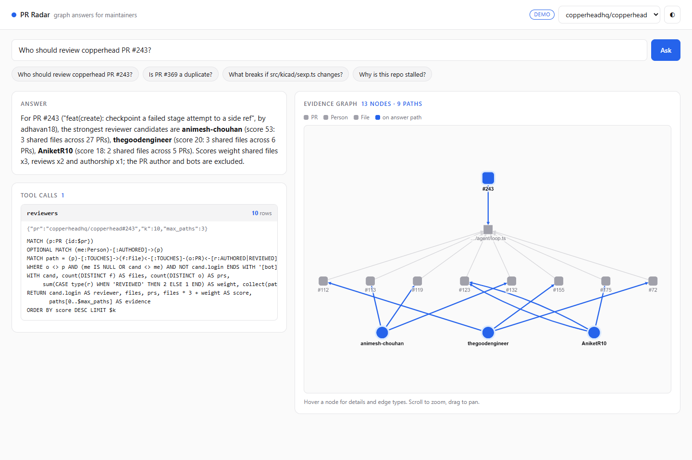
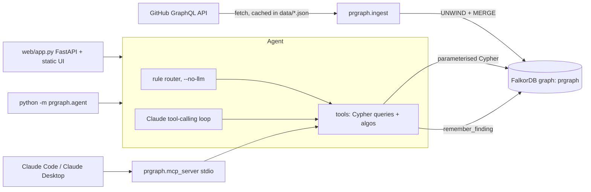
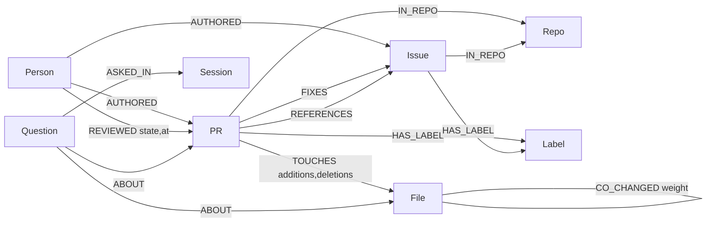

# PR Radar

**Graph-backed answers for open-source maintainers, with the evidence path for every claim.**

Busy repos drown in pull requests. Three or four people fix the same issue in parallel, a newcomer opens a PR and nobody knows who should look at it, a change to one file quietly breaks the file it always changes with, and a repo stalls without anyone noticing why. These are all questions about *connections*: PR to issue, PR to file, file to file, person to PR. PR Radar loads a GitHub repo's PRs, issues, files, authors and reviews into FalkorDB, and an agent answers those questions with Cypher. Every answer comes back with the graph paths behind it (`alice -AUTHORED-> PR#12 -TOUCHES-> src/x.py <-TOUCHES- PR#40`), so a maintainer can check the reasoning instead of trusting a summary.



**Tracks entered:** Track 01, *Agents That Act on Connected Data* (primary). It also touches Track 02 (graph memory): the agent writes what it learned back into the same graph as `Question` nodes linked to the PRs, files and people they were about.

## Architecture



## Graph data model



| Node | Key | Main properties |
|------|-----|-----------------|
| Repo | `id` = `owner/repo` | name |
| PR | `id` = `owner/repo#N` | number, title, state, created, merged, closed, url, tokens |
| Issue | `id` = `owner/repo#N` | number, title, state, created, closed, url, tokens |
| Person | `login` | is_bot |
| File | `id` = `owner/repo:path` | path |
| Label | `id` = `owner/repo:name` | name |
| Question / Session | `id` | agent memory: text, answer, evidence, at |

| Edge | From -> To | Meaning |
|------|-----------|---------|
| AUTHORED | Person -> PR/Issue | author |
| REVIEWED | Person -> PR | one edge per review state |
| TOUCHES | PR -> File | files changed |
| FIXES / REFERENCES | PR -> Issue | closing refs vs other `#N` mentions |
| CO_CHANGED | File - File | weight = number of PRs changing both (derived at ingest) |
| IN_REPO, HAS_LABEL | PR/Issue -> Repo/Label | membership |
| ASKED_IN, ABOUT | Question -> Session / entity | agent memory |

Full detail: [docs/MODEL.md](docs/MODEL.md). Every Cypher statement (questions, algorithms, memory and ingestion) is in [docs/QUERIES.md](docs/QUERIES.md), generated from the source by `python -m prgraph.gendocs`.

## Questions it answers

| Question | Queries / algorithms (`prgraph/queries.py`, `prgraph/algos.py`, `prgraph/agent/memory.py`) |
|----------|--------------------------------------|
| Is this PR a duplicate / already fixed? | `dup_shared_issue`, `dup_file_overlap`, `dup_similar_title` |
| Is this issue already being fixed? | `issue_fixed_by` |
| Who should review this PR? | `reviewers` |
| What else is at risk if this PR / file changes? | `impact`, `impact_file` |
| Why is the repo stalled? | `stale_open_prs`, `last_merges`, `reviewer_load` |
| Who are the key maintainers? | `key_maintainers` (FalkorDB `algo.pageRank`) |
| How is X connected to Y? | `connection` (`shortestPath`) |
| What did we already find about X? | `remember_finding`, `recall_about` (graph memory) |

## Why a graph

Each answer is a multi-hop traversal, and the hop path *is* the explanation:

- reviewers = PR -> its files -> other PRs on those files -> their authors and reviewers, ranked. In tables that is a four-way self-join per request.
- duplicates via a shared issue or overlapping files are 2-hop patterns; title similarity alone (what a text search gives you) misses them.
- `impact` walks `CO_CHANGED` edges derived from history; `key_maintainers` runs PageRank over the whole Person-PR-File graph; `connection` is `shortestPath` across any node types.
- agent memory lives in the same graph, so a recalled finding is linked to the actual PR or file node it was about.

Remove FalkorDB and nothing works: there is no other store, every tool is a Cypher query, and evidence paths are FalkorDB `Path` results rendered as text.

## Setup

Requirements: Python 3.11+, a FalkorDB instance, optionally `gh` (only to fetch new repos) and an Anthropic API key (only for the free-form LLM agent).

```sh
pip install -r requirements.txt

# FalkorDB: local Docker ...
docker run -p 6379:6379 -it --rm falkordb/falkordb
# ... or a free FalkorDB Cloud instance (copy host, port, user, password)
```

Create `.env` in the repo root (loaded automatically by `prgraph/db.py`; real environment variables win):

```
FALKORDB_HOST=localhost
FALKORDB_PORT=6379
FALKORDB_USERNAME=               # cloud only
FALKORDB_PASSWORD=               # cloud only
PRGRAPH_GRAPH=prgraph            # optional graph name
ANTHROPIC_API_KEY=               # optional; without it the rule router is used
PRGRAPH_REPO=sqlfluff/sqlfluff   # default repo for the MCP server
```

Ingest (the cached snapshots in `data/` are used, so these two need no GitHub access):

```sh
python -m prgraph.ingest sqlfluff/sqlfluff
python -m prgraph.ingest copperheadhq/copperhead
python -m prgraph.ingest owner/other-repo --limit 200   # new repo: needs `gh auth login`
```

Check everything against the live DB (ingests both cached repos, runs every query and algorithm once, prints row counts and errors):

```sh
python scripts/smoke.py
```

### Web UI

```sh
uvicorn web.app:app --reload           # http://localhost:8000
PRGRAPH_DEMO=1 uvicorn web.app:app     # demo mode: canned answers from web/demo_responses.json, no DB needed
```

### Agent CLI

```sh
python -m prgraph.agent "who should review PR 8550" --repo sqlfluff/sqlfluff --no-llm
python -m prgraph.agent "is PR 279 a duplicate?" --repo copperheadhq/copperhead   # LLM agent if ANTHROPIC_API_KEY is set
```

### MCP server (Claude Code / Claude Desktop)

```sh
claude mcp add pr-radar -e FALKORDB_HOST=localhost -e PRGRAPH_REPO=sqlfluff/sqlfluff -- python -m prgraph.mcp_server
```

Claude Desktop `claude_desktop_config.json`:

```json
{"mcpServers": {"pr-radar": {"command": "python", "args": ["-m", "prgraph.mcp_server"],
  "cwd": "/path/to/prgraph",
  "env": {"FALKORDB_HOST": "localhost", "PRGRAPH_REPO": "sqlfluff/sqlfluff"}}}}
```

Every tool takes an optional `repo` argument overriding `PRGRAPH_REPO`.

### Tests

```sh
python -m pytest     # offline: no DB or network needed
```

## Deployment

`Dockerfile` runs `web/app.py` with uvicorn on `$PORT`. `render.yaml` is a Render blueprint (free plan) that starts in demo mode (`PRGRAPH_DEMO=1`); point the `FALKORDB_*` variables at a FalkorDB Cloud instance and set `PRGRAPH_DEMO=0` for live answers.

```sh
docker build -t pr-radar . && docker run -p 8000:8000 --env-file .env pr-radar
```

Demo video script: [docs/DEMO_SCRIPT.md](docs/DEMO_SCRIPT.md).

## Data

Only public GitHub data from the GraphQL API. Cached snapshots for `copperheadhq/copperhead` and `sqlfluff/sqlfluff` (most recent 200 PRs and issues each) are in `data/`.

## Limitations

- Ingests the most recent N PRs and issues (default 200) and the first 100 files per PR; older history is not in the graph.
- GitHub PR and issue numbers share one sequence, so a `#N` mention of a PR becomes an Issue node.
- Title similarity is token Jaccard, not embeddings.
- `CO_CHANGED` skips PRs touching more than 50 files and keeps only weight >= 2.
- PageRank runs over the whole graph and filters to people afterwards; with many repos in one graph, scores mix repos.
- The rule router (`--no-llm`) only understands demo-style questions; free-form questions need the LLM agent.

## AI assistance

Built with Claude Code (Anthropic) assistance: code, Cypher, tests and docs were drafted with AI help. I reviewed, ran and verified everything, including the queries against the real repo data.
